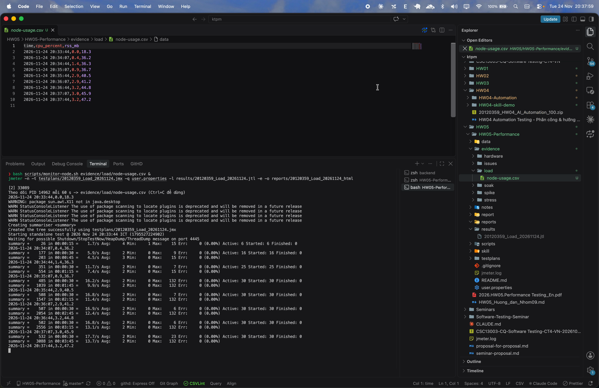
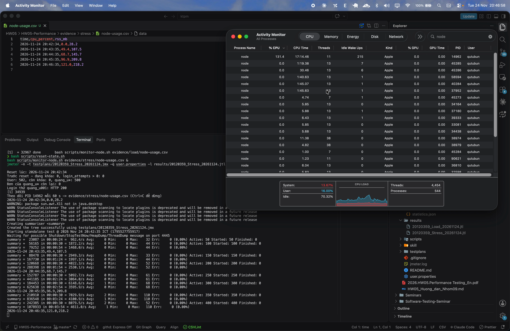
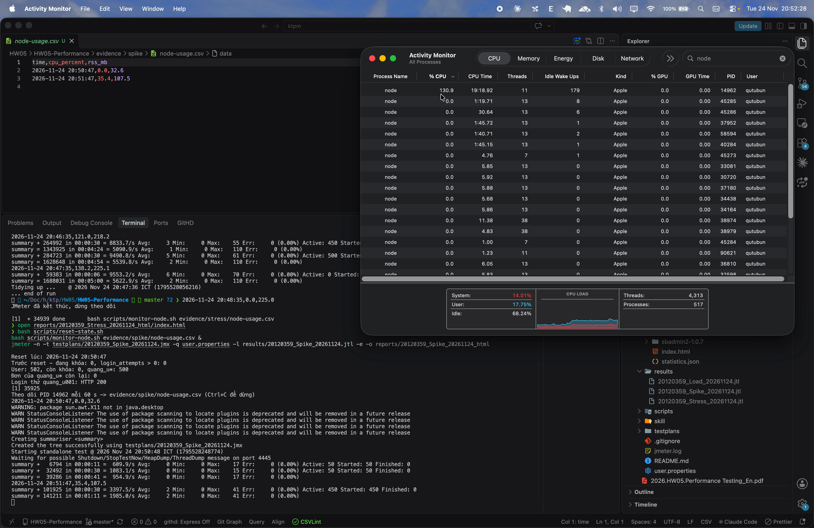
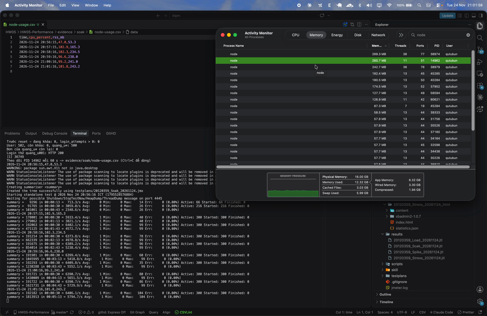

# HW05 – Performance Testing với JMeter (AI-first)

## 1. Thông tin chung

| Mục | Nội dung |
| --- | --- |
| MSSV | 20120359 |
| Họ tên | Nguyễn Đức Quang (nhóm 09) |
| Workflow | W2 – Browse & Coupon |
| Repo | https://github.com/ducquang2/HW05-Performance |
| Video demo | https://youtu.be/KncU1IYrMR4 |
| SUT | EShop backend (fork `kqanGit/eshop-sut`, commit `7dc3e0d`), Node.js + Express 5 + SQLite (`sqlite3`, 1 connection), chạy local `http://localhost:3000` |
| Công cụ | Apache JMeter 5.6.3, OpenJDK 17.0.9, chỉ dùng Thread Group có sẵn (không cài plugin) |
| AI | Claude Code (Claude Opus 5.5), nhật ký ở `report/AI_Audit_Report.md` |

Phần cứng (chi tiết ở [`evidence/hardware/hardware.md`](../evidence/hardware/hardware.md), ảnh [`hardware-fastfetch.png`](../evidence/hardware/hardware-fastfetch.png)):

| Mục | Giá trị |
| --- | --- |
| Hostname | `qutubun-machine` |
| Máy | MacBook Pro (Mac14,9), Apple M2 Pro 10 nhân (6P + 4E) |
| RAM / ổ đĩa | 16 GB / SSD 460 GB |
| Hệ điều hành | macOS 26.4.1 (25E253) |
| Node.js | v24.14.0 |

Backend và JMeter chạy **chung một máy** (xem mục 10).

## 2. Workflow nhóm và W2

### 2.1 Bảng phân công cuối cùng (nhóm 09)

Giữ nguyên đề xuất trong file phân công, không đổi người.

| | Quân (W1 – Search & Buy) | **Quang (W2 – Browse & Coupon)** | Phúc (W3 – Detail, Buy & History) |
|---|---|---|---|
| Auth | Login hợp lệ | Login hợp lệ + xem profile | Login + nhánh sai mật khẩu kiểm tra lockout |
| Read | Tìm kiếm → chi tiết | Danh sách theo category → chi tiết | Chi tiết trực tiếp theo product ID |
| Transactional | Thêm giỏ → checkout không coupon | Thêm giỏ → áp coupon → checkout | Thêm giỏ → checkout → lịch sử đơn |
| CSV chính | users, keywords | users, categories, coupons | users (đúng + sai), product IDs |

W2 khác W1 và W3 ở cả 3 điểm (điểm vào read, có coupon, bước phụ profile), đạt yêu cầu "khác ít nhất 2/3".

Khác biệt so với bảng phân công: backend **không có** lọc theo category và **không có** phân trang (`GET /api/products` chỉ đọc `?search=`, `server.js:141-157`; gọi `?category_id=2&page=2&limit=1` vẫn trả đủ 5 sản phẩm). Đặc tả FR-05 cũng không yêu cầu. Vì vậy em lọc category ở phía JMeter (JSON Extractor), còn phân trang là gap không test được.

### 2.2 W2 phủ 3 nhóm endpoint

| Nhóm | Bước | Giải thích |
|---|---|---|
| Auth | 1 Login, 2 Profile | Mỗi vòng login bằng tài khoản riêng trong `users.csv` (mật khẩu luôn đúng) rồi gọi `/api/users/me` bằng JWT vừa lấy, phủ cả cấp token lẫn kiểm tra token. Login đúng cũng chạy `UPDATE users` nên đây là thao tác ghi SQLite. |
| Read | 3 Categories, 4 Products, 5 Detail | 3 request đọc liên tiếp, là phần nhiều request nhất của vòng lặp; `GET /api/products` trả nhiều dữ liệu nhất. |
| Transactional | 6 Cart, 7 Apply coupon, 8 Checkout | Thêm giỏ (ghi RAM), áp coupon (đọc bảng coupons, tính tiền), checkout (`INSERT orders` vào SQLite). |

## 3. Thiết kế test plan

### 3.1 Các bước W2

Endpoint đã xác minh bằng curl, ghi ở [`notes/sut-endpoints.md`](../notes/sut-endpoints.md).

| # | Bước | Endpoint | Extractor | Assertion |
|---|---|---|---|---|
| 1 | Login | `POST /api/login` `{"email","password"}` | `$.token` → `token` | 200, có `$.token`; Stress/Spike/Soak thêm assertion phát hiện LOCKOUT |
| 2 | Profile | `GET /api/users/me` + `Bearer ${token}` | – | 200, `$.email == ${email}` |
| 3 | Categories | `GET /api/categories` | – | 200, có `$[0].id` |
| 4 | Products | `GET /api/products` | `$[?(@.category_id == ${category_id})].id` (Match No. 0, ngẫu nhiên) → `product_id` | 200, `product_id` không rỗng |
| 5 | Detail | `GET /api/products/${product_id}` | `$.price` → `price` | 200, `$.id == ${product_id}` (id sai vẫn trả `200 {}`), body chứa `"category_id":${category_id}` |
| 6 | Add to cart | `POST /api/cart` `{"product_id","quantity":1,"price"}` + token | – | 200, `Added to cart` |
| 7 | Apply coupon | `POST /api/apply-coupon` `{"code","total_amount"}` | `$.final_amount`, `$.coupon_id` | 200, `"success":true`, `final_amount < total_amount` |
| 8 | Checkout | `POST /api/checkout` `{"total_amount":${final_amount},"shipping_address":"HCM","coupon_id"}` + token | – | 200, có `$.orderId` |

Assertion kiểm tra cả status code và nội dung. Mỗi request chỉ có 1 JSON Assertion đặt cuối, kiểm tra phụ dùng Response Assertion dạng Substring (lý do ở mục 4).

Cố ý không làm trong luồng tải: không gửi `user_id` ở apply-coupon và không gọi `/api/coupon-usage` (nếu ghi lượt dùng thì từ vòng 2–3 coupon bị từ chối 400, lỗi dữ liệu chứ không phải hiệu năng); không dùng SAVE10 (tính giảm giá âm) và EXPIRED; không search, không sai mật khẩu, không xem lịch sử đơn (phần của Quân/Phúc).

### 3.2 Dữ liệu CSV

Sinh bằng `node scripts/setup-users.js 500` (đăng ký qua API, đọc categories từ API thật).

| File | Số dòng | Nội dung | Cấu hình |
|---|---|---|---|
| `data/users.csv` | 500 | `quang_u001..quang_u500@eshop.com`, mật khẩu `Quang1234!` | All threads, Recycle True |
| `data/categories.csv` | 3 | 1 Điện thoại, 2 Laptop, 3 Phụ kiện | All threads, Recycle True |
| `data/coupons.csv` | 2 | `VIP100,600000`, `BIGBUY,600000` | All threads, Recycle True |

- 500 tài khoản ≥ số VU lớn nhất (Stress 500), nên tại một thời điểm mỗi VU dùng tài khoản khác nhau. Recycle an toàn vì mỗi vòng login lại bằng mật khẩu đúng.
- `total_amount = 600000` lớn hơn ngưỡng của cả 2 coupon (backend so `>` chứ không phải `>=`).
- Không cần nạp tồn kho: bảng `products` không có cột tồn kho, checkout không trừ kho.

### 3.3 Think-time

Think-time đặt bằng Flow Control Action (Pause 0 ms) có Uniform Random Timer làm con, nằm **giữa** các Transaction Controller (7 chỗ, trước bước 2–8). Tham số đọc từ property `${__P(think_min)}`, `${__P(think_range)}` để chạy thử nhỏ không phải sửa file.

### 3.4 Tham số từng test plan

Đã đối chiếu lại các giá trị mặc định `__P(...)` trong file `.jmx`.

| Plan | Thread Group | VU | Ramp / hình dạng | Thời gian | Think | Listener |
|---|---|---|---|---|---|---|
| `20120359_Load_20261124.jmx` | 1 | 30 | ramp 90 s | duration 390 s (90 ramp + 300 giữ) | 1–3 s | Summary Report |
| `20120359_Stress_20261124.jmx` | 10 (mỗi nhóm 1 bậc) | 50 → 500 | +50 VU mỗi 30 s, ramp mỗi bậc 5 s, các bậc cùng kết thúc ở giây 300 | 300 s | 0–100 ms | Aggregate Report |
| `20120359_Spike_20261124.jmx` | 2 | nền 50 + đỉnh 400 | nền ramp 10 s suốt 210 s; đỉnh vào ở giây 60, ramp 5 s, giữ 60 s rồi dừng cùng lúc | 210 s | 0–100 ms | View Results Tree (Errors only) |
| `20120359_Soak_20261124.jmx` | 1 | 300 | ramp 60 s | duration 660 s (60 ramp + 600 giữ) | 0–100 ms | Không thêm (chạy CLI) |

Lý do chọn:

- **Load 30 VU, think 1–3 s:** nằm giữa khoảng 20–50 VU gợi ý, là tải "người dùng thật". Ramp 90 s (3 s thêm 1 VU) để không dồn 30 lệnh login (ghi DB) cùng lúc. Ước lượng 1 vòng ≈ 14 s, khoảng 17 req/s.
- **Stress 500 VU, think 0–100 ms:** bản đầu dùng gợi ý chung (+20 VU/60 s, trần 200 VU, think 0,5–1 s) chạy đủ 10 phút **không gãy**: bậc 200 VU chỉ 301,5 req/s, p95 3 ms, 0% lỗi, CPU node ~20%. SUT chỉ mất ~1 ms/request nên VU gần như chỉ "nghĩ". Chạy dò think 0–100 ms tới 200 VU: 3.994 req/s, p95 3 ms, CPU node ~70%, vẫn 0 lỗi. Từ đó ước lượng ~20 req/s và ~0,35% CPU node mỗi VU, node chạm 100% CPU ở khoảng 280–300 VU, nên đặt trần 500 VU (+50 VU/bậc) để điểm bão hòa nằm giữa lượt chạy. Bậc 60 s làm `.jtl` 903 MB nên rút còn 30 s/bậc.
- **Spike nền 50 + đỉnh 400 (tổng 450):** nền bằng bậc 1 của Stress để có số "bình thường" so sánh. Tổng 450 VU vượt vùng bão hòa 400–450 VU của Stress, gấp 9 lần nền, ramp 5 s (80 VU/s) nên đủ đột ngột. Sau spike còn 85 s chỉ có nền để xem hồi phục. Think giống Stress để số VU so được trực tiếp.
- **Soak 300 VU, 10 phút:** 300 VU là bậc cuối của Stress còn tăng tuyến tính (khoảng 75% của 400 VU), p95 3 ms, 0% lỗi. Think giống Stress vì think 1–2 s theo gợi ý chung sẽ cần hàng nghìn VU mới tới gần ngưỡng.

Lệnh chạy chính thức (từ root repo):

```bash
jmeter -n -t testplans/20120359_<Type>_20261124.jmx -q user.properties \
       -l results/20120359_<Type>_20261124.jtl -e -o reports/20120359_<Type>_20261124_html
```

`user.properties` bật `failureMessage`, `Latency`, `Connect`, `thread_counts`, `bytes` trong `.jtl`.

## 4. Review test plan do AI sinh

Tóm tắt từ [`notes/review-testplans.md`](../notes/review-testplans.md). Chỉ ghi lỗi thật thấy khi chạy thử hoặc khi tự kiểm tra.

| Plan | AI sai gì | Em sửa thế nào | Vì sao AI sai |
|---|---|---|---|
| Load | Timer đặt trong Transaction Controller; hết Duration khi thread đang "nghĩ" thì JMeter vẫn ghi 1 sample transaction 0 ms success (chạy thử có 5 sample như vậy) | Đưa think-time ra giữa các Transaction Controller bằng Flow Control Action; chạy lại số sample transaction bằng số sample request | Giới hạn mô hình: không lường được cách JMeter dừng thread theo scheduler |
| Load | 2 JSON Assertion trên cùng 1 request; khi cố ý làm sai thì `failureMessage` trong `.jtl` rỗng vì assertion đạt vẫn gán message `""` | Mỗi request 1 JSON Assertion đặt cuối, kiểm tra phụ đổi sang Response Assertion Substring; thử lại `.jtl` ghi đúng message lỗi | Chi tiết cài đặt của JMeter 5.6.3; prompt chỉ yêu cầu "chạy thông", chưa yêu cầu thử trường hợp lỗi |
| Stress/Spike | Dòng `còn khóa` của `reset-state.sh` in sau lệnh mở khóa nên luôn ra 0 | Thêm dòng `Trước reset - đang khóa: X` in trước khi mở khóa | Script viết cho mục đích mở khóa, AI không xem lại khi dùng cho mục đích kiểm tra |
| Stress | Lấy gợi ý chung (think 0,5–1 s, trần 200 VU) làm thông số, chạy 10 phút không gãy | Think 0–100 ms, +50 VU/bậc, trần 500 VU, `users.csv` lên 500 tài khoản | Lúc sinh plan chưa có số liệu năng lực máy |
| Stress | Giữ 60 s mỗi bậc, không ước lượng dung lượng: `.jtl` 903 MB | Rút còn 30 s/bậc, `.jtl` và `reports/` cho vào `.gitignore`, nộp trong zip | Prompt không nói giới hạn dung lượng nộp bài |
| Spike | Đỉnh 160 VU think 0,5–1 s, ước chỉ ~240 req/s, gần như không tạo áp lực | Nền 50 VU, đỉnh +400 VU, think 0–100 ms | Chưa có số liệu Stress khi sinh Spike |

Đã đối chiếu danh sách lỗi hay gặp (mục 2.3 file hướng dẫn) và **không** gặp: think-time bằng 0, thiếu extractor token hoặc header `Authorization`, mật khẩu sai trong luồng tải, dùng chung 1 tài khoản, trùng listener, bật View Results Tree khi tải cao (Spike chỉ để Errors only và chạy CLI), sai tên file.

## 5. Quy trình reset lockout

Cơ chế thật của SUT (`server.js:40-64`, đã thử bằng curl): sai mật khẩu cộng `login_attempts` thêm 2, `>= 3` thì khóa 3 phút, nên thực tế **sai 2 lần là khóa** (đặc tả: 3 lần, 30 giây). Hết khóa thì bộ đếm không về 0. Không có endpoint admin mở khóa. W2 chỉ dùng mật khẩu đúng nên luồng tải không tự khóa tài khoản, nhưng vẫn reset trước và sau mỗi lượt.

Các bước (script [`scripts/reset-state.sh`](../scripts/reset-state.sh), chạy khi JMeter đã dừng):

1. Dừng JMeter (nếu còn chạy).
2. In giờ reset và dòng `Trước reset - đang khóa: X, login_attempts > 0: Y` (để biết lượt vừa rồi có làm khóa user nào không).
3. Mở khóa: `UPDATE users SET login_attempts = 0, locked_until = NULL;` trên `backend/database.sqlite`.
4. Xóa `orders` và `coupon_usage` của user `quang_u*`. Không cần nạp tồn kho.
5. Login thử `quang_u001`, phải ra HTTP 200 thì mới chạy tiếp.
6. Bật `scripts/monitor-node.sh evidence/<type>/node-usage.csv` rồi chạy JMeter.
7. Chạy xong, chạy lại `reset-state.sh` và đọc dòng "Trước reset".

Giỏ hàng nằm trong RAM backend, không có API xóa. Muốn xóa phải restart backend, mà restart thì DB bị DROP và seed lại (`database.js:13-20`), nên phải chạy lại `node scripts/setup-users.js`.

Để phân biệt lỗi dữ liệu với lỗi tải, plan Stress/Spike/Soak có assertion ở bước login: nếu body chứa "bị khóa" thì `.jtl` ghi `LOCKOUT 403: ... lỗi dữ liệu, không phải lỗi tải`. Em đã thử khóa `quang_u001`, `quang_u002` bằng SQL rồi chạy, `.jtl` ghi đúng message này. Không dùng mã 403 làm dấu hiệu vì middleware token cũng trả 403 khi token sai. Ở 4 lượt chính thức không có sample lỗi nào, nên không có lần login nào bị khóa.

## 6. Kết quả 4 lượt chạy

Số liệu tính lại từ `.jtl` gốc bằng `scripts/analyze-jtl.py` (chỉ request HTTP, bỏ dòng Transaction Controller, percentile trên toàn bộ sample). Không lấy percentile trong HTML report vì `statistics.json` chỉ tính trên cửa sổ 20.000 sample (xem mục 7).

| Lượt | Giờ chạy (24/11) | Request | Thời gian | req/s TB | Avg (ms) | p90 | p95 | p99 | Max | Lỗi |
|---|---|---|---|---|---|---|---|---|---|---|
| Load | 20:33:45 – 20:40:14 | 5.916 | 390 s | 15,2 | 2,28 | 4 | 5 | 6 | 132 | 0 |
| Stress | 20:42:36 – 20:47:36 | 1.688.031 | 300 s | 5.625,9 | 2,63 | 6 | 8 | 13 | 110 | 0 |
| Spike | 20:50:48 – 20:54:18 | 720.805 | 210 s | 3.433,9 | 3,19 | 7 | 8 | 11 | 80 | 0 |
| Soak | 20:56:17 – 21:07:17 | 4.030.538 | 660 s | 6.106,9 | 1,40 | 2 | 3 | 5 | 135 | 0 |

Giờ chạy lấy từ timestamp dòng đầu và dòng cuối trong `.jtl`. CPU/RAM process `node` lấy từ `evidence/<type>/node-usage.csv` (mẫu mỗi ~60 s bằng `ps`).

### 6.1 Load (30 VU)



- p95 5 ms, p99 6 ms, 0 lỗi. Throughput TB 15,2 req/s (tính cả 90 s ramp), sát ước lượng ~17 req/s.
- Checkout chậm nhất (avg 4,52 ms, p95 6 ms) vì là `INSERT` vào SQLite; các request khác avg 1,44–2,35 ms.
- Max 132 ms ở checkout. Có 4 request trên 50 ms ở 4 endpoint khác nhau (users/me 72, checkout 132, categories 122, apply-coupon 83 ms), là một đợt chậm ngắn chứ không phải 1 điểm lẻ.
- CPU node ≤ 4,8%, RSS 18,3 → 49,2 MB.

### 6.2 Stress (50 → 500 VU)



Từng bậc (cửa sổ 30 s, tính bằng `skill/eshop-jmeter-perf/scripts/jtl-windows.py`):

| VU | req/s | p50 | p95 | p99 | Max | Lỗi |
|---|---|---|---|---|---|---|
| 50 | 995,7 | 1 | 2 | 3 | 32 | 0% |
| 100 | 2.091,0 | 1 | 2 | 3 | 44 | 0% |
| 150 | 3.170,3 | 1 | 2 | 3 | 52 | 0% |
| 200 | 4.257,0 | 1 | 2 | 3 | 43 | 0% |
| 250 | 5.304,7 | 1 | 2 | 4 | 61 | 0% |
| 300 | 6.364,7 | 1 | 3 | 4 | 68 | 0% |
| 350 | 7.226,6 | 1 | 5 | 26 | 110 | 0% |
| 400 | 8.243,8 | 2 | 6 | 9 | 55 | 0% |
| 450 | 8.993,5 | 3 | 8 | 12 | 61 | 0% |
| 500 | 9.616,8 | 5 | 11 | 16 | 70 | 0% |

CPU node theo phút: 49,4% → 68,7% → 96,9% → 121,0% → 138,2%; RSS 28,2 → 225,1 MB.

Nhận xét:
- **Không gãy cứng tới 500 VU:** 0 lỗi ở mọi bậc, throughput vẫn tăng.
- **Bão hòa bắt đầu ở 400–450 VU:** p50 bắt đầu tăng (2 → 3 → 5 ms), mức tăng throughput mỗi bậc giảm (+1.017, +750, +623 req/s so với +1.050–1.100 ở các bậc 100–300 VU), CPU node vượt 100%.
- Bậc 350 VU có p99 26 ms nhưng chỉ do một đợt chậm khoảng 10 s (190–200 s); bậc 400 VU trở lại p99 9 ms. Đây là chỗ AI đọc sai (mục 7).
- So với lượt chạy thử bậc 60 s trước đó (`notes/workflow-w2.md` mục 6) thì số hơi khác (ví dụ 500 VU: 8.725 req/s, p95 19 ms) nhưng cùng kết luận bão hòa quanh 400–450 VU. Report lấy số của lượt chính thức ở trên.

### 6.3 Spike (50 → 450 → 50 VU)



| Giai đoạn | Thời gian | VU | req/s | p95 | p99 | Lỗi |
|---|---|---|---|---|---|---|
| Nền trước spike | 10–60 s | 50 | 1.078–1.092 | 2 | 3 | 0% |
| Vào spike | 60–70 s | 50 → 450 | 7.213 | 7 | 11 | 0% |
| Đỉnh | 70–120 s | 450 | 8.955–9.107 | 8–9 | 11–17 | 0% |
| Hồi phục | 130–210 s | 50 | 1.067–1.094 | 2 | 3–4 | 0% |

CPU node: 35,4% (nền) → 130,9% (đỉnh) → 38,9% (hồi phục). RSS 107,5 → 228,8 → 230,3 MB, sau khi dừng còn 117,9 MB.

Nhận xét: chịu được spike gấp 9 lần trong 5 s mà không có lỗi. Latency hồi phục ngay trong cửa sổ 10 s đầu sau spike (p95 về 2 ms, bằng nền). RAM thì không hồi phục: RSS giữ ~230 MB suốt giai đoạn hồi phục.

### 6.4 Soak (300 VU, 10 phút) và ngưỡng endurance



- Throughput mỗi phút sau ramp ~6.370–6.410 req/s, p95 luôn 3 ms, p99 5–6 ms (riêng phút 2–3 là 9 ms), 0 lỗi trên hơn 4 triệu request. Latency không tăng dần theo thời gian.
- RSS node: 234,5 MB (hết ramp, 20:58:16) → 274,3 MB (cuối test, 21:07:16), tăng đều khoảng **4,4 MB/phút**, không đi ngang. Sau khi dừng 1 phút vẫn 274,3 MB, 2 phút sau còn 149,7 MB. Nguyên nhân nghi ngờ: giỏ hàng `userCarts` trong RAM không bao giờ được xóa (issue #174).

| Chỉ số | Giá trị |
|---|---|
| Số VU ổn định tối đa | **300 VU** (think 0–100 ms) |
| Max stable RPS | **~6.390 req/s** |
| p95 tại ngưỡng | **3 ms** (p99 5 ms) |
| Error rate | **0%** |
| RAM đỉnh node (memory ceiling) | **274,3 MB** |
| RAM sau ramp → cuối | 234,5 → 274,3 MB (~4,4 MB/phút, nghi rò rỉ) |
| CPU node trung bình / đỉnh (lúc giữ tải) | ~93% / 102,9% |

Ghi chú: mẫu đầu file monitor (20:56:15, RSS 53,3 MB) đã có CPU 47%, tức tải đã bắt đầu, nên không dùng làm mức nền. CPU trung bình là trung bình 11 mẫu từ 20:57:15 đến 21:07:16.

Mức 350 VU trở lên chưa chạy bền lần nào, nên em chỉ chốt ngưỡng endurance là 300 VU.

## 7. Task 2 – AI phân tích kết quả và soi lỗi

Chi tiết: [`task2-review.md`](task2-review.md), output nguyên văn của AI: [`task2-ai-analysis.md`](task2-ai-analysis.md).

Em đưa cho AI 4 file `.jtl`, 4 HTML report, 4 test plan, `node-usage.csv` và source backend. AI ghi đúng các số tổng, và chỉ ra đúng một điểm em suýt bỏ qua: percentile trong HTML report chỉ tính trên 20.000 sample (ví dụ Spike p95 report 2 ms, thật 8 ms).

6 chỗ AI đọc sai hoặc suy diễn quá dữ liệu:

| # | AI nói | Thực tế trong `.jtl` |
|---|---|---|
| 1 | Điểm gãy mềm 350–400 VU vì bậc 350 p99 26 ms | Chỉ 10 s có p95 17 ms; bậc 400 VU trở lại bình thường. Bão hòa thật ở 400–450 VU |
| 2 | Load max 132 ms chỉ xuất hiện 1 lần | 4 request > 50 ms ở 4 endpoint khác nhau |
| 3 | WAL giảm "2–5 lần" thời gian ghi vì checkout chậm nhất | Checkout chỉ chậm nhất ở Load; ở Soak/Stress chênh rất ít. Số "2–5 lần" do AI tự đưa ra |
| 4 | Throughput sẽ đi ngang ~10.000 req/s rồi mới lỗi | Ngoại suy, không có lượt nào vượt 500 VU |
| 5 | SLA "tải thường ≤ 300 VU" nhưng khuyến nghị tối đa 350 VU | Tự mâu thuẫn; Soak chỉ kiểm chứng 300 VU |
| 6 | RAM Soak gấp 3 so với lúc đầu (53 MB) | Mẫu 53 MB đã có tải; backend chưa tải chỉ ~18–28 MB |

Đánh giá 8 đề xuất tối ưu:

| # | Đề xuất | Kết luận |
|---|---|---|
| O1 | Xóa `userCarts[userId]` sau checkout / chuyển giỏ vào DB | Khả thi, nên làm trước (sửa rò rỉ RAM) |
| O2 | Bật SQLite WAL | Khả thi nhưng ít tác dụng (ghi DB không phải nút cổ chai) |
| O3 | Index `users(email)`, `orders(user_id)`, `coupon_usage` | Khả thi một phần, không liên quan W2 |
| O4 | Login chỉ `UPDATE` reset lockout khi cần | Khả thi |
| O5 | Cache categories/products trong RAM | Khả thi |
| O6 | Connection pool / `better-sqlite3` để đọc song song nhiều core | **Hallucinated** (`better-sqlite3` là đồng bộ, `sqlite3` không có pool) |
| O7 | `cluster` / PM2 nhiều process | Không khả thi với code hiện tại (mỗi process khởi động sẽ DROP + seed lại DB) |
| O8 | Không `SELECT *`, không trả `password` | Khả thi, chủ yếu là sửa lỗi bảo mật |

## 8. Task 3 – Continuous Performance Testing

Chi tiết và flow chart: [`task3-cpt-proposal.md`](task3-cpt-proposal.md). Đây là đề xuất, em chưa cài pipeline thật.

- **Lọc theo đường dẫn file:** chỉ đụng `*.md`, `frontend-*` thì bỏ qua; đụng `backend/server.js`, `database.js`, `package.json` thì chạy.
- **Các tầng:** smoke 5 VU (~2 phút) → PR chạy Load 30 VU rút gọn 3 lần (~12 phút) → nightly trên `main` chạy Stress + Soak kèm theo dõi RSS (~25 phút).
- **Phát hiện regression:** ngưỡng kép p95 tăng > 20% **và** > 2 ms (vì p95 chỉ vài ms, 3 → 4 ms đã là +33%), lấy median 3 lần, bỏ ramp, xét theo từng endpoint. Stress cần vượt ngưỡng ở ≥ 2 bậc liên tiếp (tránh đợt chậm 10 s như bậc 350 VU). Error > 0,1% là fail ngay. RSS slope Soak > ~1 MB/phút thì gắn cờ. Percentile lấy từ `.jtl`.
- **Baseline** chỉ cập nhật khi merge `main` và có người duyệt, tránh baseline trôi dần.
- **Trade-off chính:** chi phí runner và dung lượng `.jtl` (Soak 1,1 GB); báo động giả do p95 nhỏ và JMeter chạy chung máy; ngưỡng kép làm lọt regression nhỏ (+1 ms ở 30 VU) tới nightly mới thấy.

## 9. Bug và performance issue

Chi tiết: [`bugs.md`](bugs.md), ảnh: [`github-issues.png`](../evidence/issues/github-issues.png). Log trên repo SUT `kqanGit/eshop-sut`.

| Issue | Loại | Mức độ | Tóm tắt |
|---|---|---|---|
| [#174](https://github.com/kqanGit/eshop-sut/issues/174) | Performance | High | `userCarts` không bao giờ giải phóng, RSS Soak 234,5 → 274,3 MB (~4,4 MB/phút) |
| [#175](https://github.com/kqanGit/eshop-sut/issues/175) | Performance | Medium | Throughput bão hòa, latency tăng từ 400–450 VU, CPU node 138% |
| [#176](https://github.com/kqanGit/eshop-sut/issues/176) | Bảo mật | High | Login và `/api/users/me` trả mật khẩu plaintext |
| [#177](https://github.com/kqanGit/eshop-sut/issues/177) | Chức năng | Low | `GET /api/products/:id` với id không tồn tại trả `200 {}` |

Tổng: 2 performance issue, 2 bug chức năng/bảo mật mới. Không có crash, cả 4 lượt 0% lỗi. Các bug đã có người log trước (#34, #35, #36, #50, #51, #162) chỉ tham chiếu, không log lại.

## 10. Hạn chế

- **JMeter chạy chung máy với backend.** Lúc chạy thử, JMeter (java) chiếm khoảng 30–40% CPU ở tải cao (lượt chính thức không đo riêng), nên điểm bão hòa đo được là của "máy này khi chạy cả hai", có thể đến sớm hơn khi tách máy.
- **Không cài plugin Custom Thread Groups.** Stress dựng bằng 10 Thread Group thường, Spike bằng 2 Thread Group, nên hình dạng tải đúng nhưng cấu hình dài hơn so với Stepping/Ultimate Thread Group.
- **Ảnh lượt Load không có Activity Monitor trong cùng khung hình.** CPU/RAM node của lượt Load chỉ có trong `evidence/load/node-usage.csv`.
- **Video demo Agent Skill chưa có.** Skill đã có ở `skill/eshop-jmeter-perf/`, mới có video demo chính.
- CPU/RAM node lấy mẫu mỗi ~60 s bằng `ps`, nên không thấy được dao động ngắn hơn 1 phút.
- Chỉ có 1 lần chạy chính thức cho mỗi loại test, chưa chạy lặp để đo độ dao động giữa các lần.
- `.jtl` và HTML report không đưa vào git vì quá giới hạn 100 MB/file (Soak ~1,1 GB). Zip nộp giới hạn 20 MB nên chỉ có 4 HTML report và `.jtl` của Load; `.jtl` của Stress, Spike, Soak để ở GitHub Release: https://github.com/ducquang2/HW05-Performance/releases/tag/results-20261124
