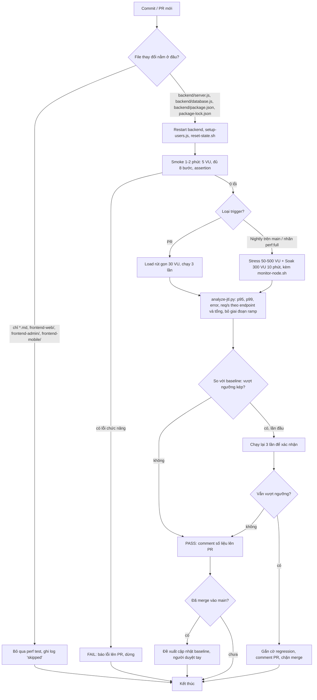

# Task 3 – Đề xuất Continuous Performance Testing cho EShop (G9.6)

## 1. Mục tiêu và phạm vi

Mục tiêu là mỗi khi repo `eshop-sut` có commit hoặc PR mới, pipeline tự quyết định có cần chạy perf test hay không, chạy kịch bản nào, rồi so p95 với baseline để gắn cờ regression. Phạm vi chỉ là workflow W2 (login → profile → categories → products → product detail → cart → apply-coupon → checkout) trên backend Node + SQLite, dùng lại 4 test plan JMeter, `scripts/setup-users.js`, `scripts/reset-state.sh`, `scripts/monitor-node.sh` và `scripts/analyze-jtl.py` của bài này. Đây mới là đề xuất, em chưa cài đặt pipeline thật. Repo SUT hiện chỉ có 3 commit (gần như toàn bộ code nằm trong "first upload"), nên bộ lọc đường dẫn dưới đây em dựa vào cấu trúc thư mục (`backend/`, `frontend-web/`, `frontend-admin/`, `frontend-mobile/`, file `.md`) chứ chưa có lịch sử commit để thống kê.

## 2. Flow chart



Bản ASCII rút gọn (phòng khi viewer không render Mermaid):

```
Commit/PR
  │
  ├─ chỉ docs / frontend-* / mobile ───────────────► BỎ QUA
  └─ backend/server.js, database.js, package.json
        │
        ▼
  Restart backend + setup-users.js + reset-state.sh
        ▼
  Smoke 5 VU, 1–2 phút ──lỗi──► FAIL, dừng
        ▼
  PR: Load 30 VU ×3        Nightly: Stress + Soak (+ monitor RSS)
        └──────────┬────────────┘
                   ▼
  analyze-jtl.py (bỏ ramp) → p95/p99/error/req/s, RSS slope
                   ▼
  So baseline (ngưỡng kép, median 3 lần)
     ├─ trong ngưỡng ──► PASS, comment PR ──(merge main)──► cập nhật baseline (duyệt tay)
     └─ vượt ──► chạy lại xác nhận ──vẫn vượt──► GẮN CỜ REGRESSION, chặn merge
                                   └─ hết vượt ──► PASS
```

## 3. Các tầng chạy

| Tầng | Trigger | Kịch bản | Thời gian (ước) | Chỉ số kiểm tra | Ngưỡng |
|---|---|---|---|---|---|
| 0. Lọc | Mọi commit/PR | Không chạy gì nếu chỉ đụng `*.md`, `frontend-*`, `frontend-mobile/` | ~0 | – | – |
| 1. Smoke | Commit đụng `backend/` | 5 VU, ramp 10 s, 60–90 s, đủ 8 bước | ~2 phút (kèm setup) | Assertion, error | 0 lỗi |
| 2. Load rút gọn | PR đụng `backend/` | `20120359_Load` với 30 VU, ramp 30 s, giữ 3 phút, chạy 3 lần | ~12 phút | p95, p99 theo endpoint và tổng, error, req/s | Xem mục 4 |
| 3. Nightly | 1 lần/đêm trên `main` (hoặc PR gắn nhãn `perf:full`) | `20120359_Stress` 50→500 VU (5 phút) + `20120359_Soak` 300 VU 10 phút, có `monitor-node.sh` | ~25 phút | p95 từng bậc, req/s ở 500 VU, error, RSS slope | Xem mục 4 |

Baseline hiện có từ bộ đo của bài: Load 30 VU p95 5 ms, p99 6 ms, 15,2 req/s; Stress 500 VU 9.617 req/s, p95 11 ms; Soak 300 VU ~6.390 req/s, p95 3 ms; tất cả 0 lỗi. RSS Soak tăng ~4,4 MB/phút (đang là bug #174, nên baseline RSS chỉ được đặt lại sau khi sửa).

## 4. Quy tắc phát hiện regression

1. **Ngưỡng kép cho p95:** gắn cờ khi `p95_mới > p95_baseline × 1,2` **và** `p95_mới − p95_baseline > 2 ms`. Áp cho tổng và cho từng endpoint (8 label `01`–`08`).
   - Lý do: p95 của bài chỉ vài ms và JMeter trả `elapsed` theo số nguyên ms. Ở Soak p95 là 3 ms, chỉ cần lên 4 ms là đã +33%, vượt ngưỡng 20% dù có thể chỉ là dao động. Ở Load, p95 5 → 6 ms là +20%. Nếu chỉ dùng %, gần như lần nào cũng báo động giả. Ngược lại nếu chỉ dùng ms tuyệt đối, ở Stress 500 VU (p95 11 ms) thì +2 ms chỉ là +18%, khá chặt. Ghép cả hai thì phải vừa tăng đáng kể theo tỉ lệ vừa tăng thật vài ms.
   - Với baseline Load (p95 5 ms) nghĩa là phải lên **≥ 8 ms** mới bị gắn cờ.
2. **Median của 3 lần chạy:** lấy trung vị p95 của 3 lần Load. Một lần lẻ bị GC hoặc máy bận không đủ làm vượt ngưỡng.
3. **Chỉ tính giai đoạn giữ tải, bỏ ramp:** ramp có ít VU nên latency thấp hơn, làm loãng số liệu. `analyze-jtl.py` hiện tính trên toàn file, cần thêm tham số bỏ N giây đầu (Load bỏ 30 s, Soak bỏ 60 s).
4. **Stress xét theo bậc, không xét tổng:** ở bậc 350 VU từng có một đợt chậm 10 s (p95 17 ms) do GC làm AI đọc sai điểm gãy (`report/task2-review.md`, lỗi #1). Vì vậy chỉ gắn cờ khi p95 vượt ngưỡng ở **≥ 2 bậc liên tiếp**, và cảnh báo khi req/s ở bậc 500 VU giảm > 10% so với 9.617 req/s.
5. **Error rate > 0,1%** là fail ngay, không cần so baseline (bộ đo hiện tại 0 lỗi ở cả 4 lượt).
6. **p99 chỉ cảnh báo, không chặn merge:** p99 dao động mạnh hơn (Load max 132 ms do một đợt chậm ngắn), dùng ngưỡng rộng hơn (+50% và > 5 ms).
7. **RSS slope ở Soak nightly:** từ `node-usage.csv` (mỗi 60 s), tính hệ số góc RSS sau ramp. Gắn cờ khi > ~1 MB/phút. Hiện tại 4,4 MB/phút nên nightly sẽ luôn đỏ cho tới khi sửa #174, đó là đúng ý.
8. **Lấy percentile từ `.jtl`, không lấy từ HTML report:** `statistics.json` chỉ tính trên cửa sổ 20.000 sample nên lệch (Spike p95 report 2 ms, thật 8 ms).

## 5. Ví dụ áp dụng

**Commit sửa #174** (thêm `delete userCarts[userId]` sau `INSERT` trong checkout, `server.js`):
- Lọc: đụng `backend/server.js` → chạy. Smoke pass.
- PR: Load 30 VU ×3. Kỳ vọng p95 vẫn ~5 ms, nằm trong ngưỡng → PASS. Load 30 VU chỉ vài phút nên không thấy được RSS; nếu muốn kiểm ngay trên PR thì gắn nhãn `perf:full`.
- Nightly sau khi merge: Soak 300 VU, kỳ vọng RSS slope về **~0 MB/phút** (dao động quanh mức sau ramp thay vì 234 → 274 MB). Khi đã ổn 2–3 đêm liên tiếp, người duyệt cập nhật baseline RSS và giữ ngưỡng 1 MB/phút để phát hiện rò rỉ mới.

**Commit thêm truy vấn chậm vào `GET /api/products`** (ví dụ một query thêm ~20 ms mỗi request):
- PR Load: label `04 GET /api/products` có p95 từ ~5 ms lên ~25 ms → vượt cả 20% lẫn 2 ms → bị bắt ngay ở **tầng 2**, theo từng endpoint. Vì products chiếm 1/8 số request (12,5% > 5%), p95 tổng cũng nhảy theo.
- Nếu query chỉ chậm thêm ~1 ms thì ở 30 VU sẽ **lọt** ngưỡng kép. Nó chỉ lộ ra ở nightly Stress, khi tải cao làm hàng đợi dồn và req/s ở 500 VU giảm. Đây là cái giá của việc chọn ngưỡng ít báo động giả.

## 6. Trade-off

| Vấn đề | Rủi ro trong bài này | Cách xử lý đề xuất | Cái giá phải chấp nhận |
|---|---|---|---|
| Chi phí | Chạy đủ 4 plan mất ~30 phút/lần (kèm setup). `.jtl` rất lớn: Soak 1,1 GB, Stress hơn 1,6 triệu sample | Lọc theo đường dẫn, PR chỉ chạy Load rút gọn (~12 phút), Stress + Soak để nightly. Giữ vĩnh viễn summary (output `analyze-jtl.py` + `node-usage.csv`), `.jtl` nén gzip (~60 MB với Soak) giữ 14 ngày rồi xóa | Không xem lại được sample gốc của lượt cũ quá 14 ngày |
| Báo động giả | p95 chỉ vài ms, dao động 1–2 ms đã là ±30–50%. JMeter chạy chung máy với backend nên tranh CPU (CPU node đã 138% ở Stress). GC tạo đợt chậm ngắn | Runner cố định (tốt nhất tách máy JMeter và backend), median 3 lần, ngưỡng kép % + ms, Stress cần 2 bậc liên tiếp, chạy lại xác nhận trước khi chặn merge | PR chạy lâu hơn (3 lần), cần thêm máy |
| Báo động sót | Ngưỡng kép làm lọt regression nhỏ (+1 ms ở 30 VU). Bộ lọc đường dẫn có thể bỏ sót thay đổi cấu hình/dữ liệu ngoài `backend/` (ví dụ `run_servers.sh`, đổi seed trong DB) | Nightly Stress + Soak chạy trên `main` bất kể path, bắt các regression nhỏ dồn lại. Cho phép gắn nhãn `perf:full` để chạy đủ khi nghi ngờ | Regression nhỏ có thể được phát hiện trễ 1 ngày |
| Baseline trôi | Nếu tự cập nhật baseline sau mỗi lần PASS, nhiều lần chậm thêm 1 ms sẽ cộng dồn mà không bao giờ vượt ngưỡng | Chỉ cập nhật baseline khi merge vào `main` và có người duyệt tay; lưu lịch sử baseline để so với mốc gốc của bài | Tốn công người duyệt |
| Môi trường | Restart backend làm `database.js` DROP TABLE và reseed, mất user test. Giỏ hàng nằm trong RAM nên RSS đầu lượt phụ thuộc lượt trước. Lockout bị kích hoạt nếu dữ liệu sai | Bước setup cố định mỗi lần: restart backend → `setup-users.js` → `reset-state.sh` → monitor → JMeter | Thêm ~1 phút mỗi lần chạy |

## 7. Hạn chế của đề xuất

- Em chưa cài đặt và chưa chạy pipeline này thật (chưa có workflow CI, chưa thêm tham số bỏ ramp vào `analyze-jtl.py`). Thời gian các tầng là ước lượng từ thời lượng test plan.
- Các con số ngưỡng (20%, 2 ms, 1 MB/phút, 10% req/s) là giả định suy ra từ **một** bộ đo trên một máy, chưa đo độ dao động giữa nhiều lần chạy lặp. Cần chạy Load khoảng 10 lần trên runner thật để chỉnh lại.
- Chỉ bao phủ workflow W2. Các endpoint W2 không gọi (admin, `my-orders`, register) có thể bị regression mà pipeline không thấy.
